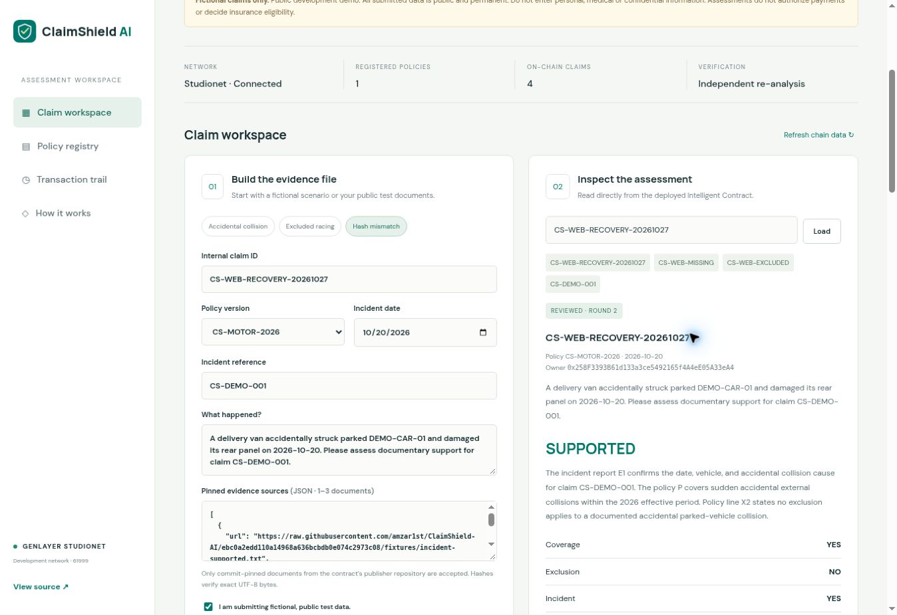
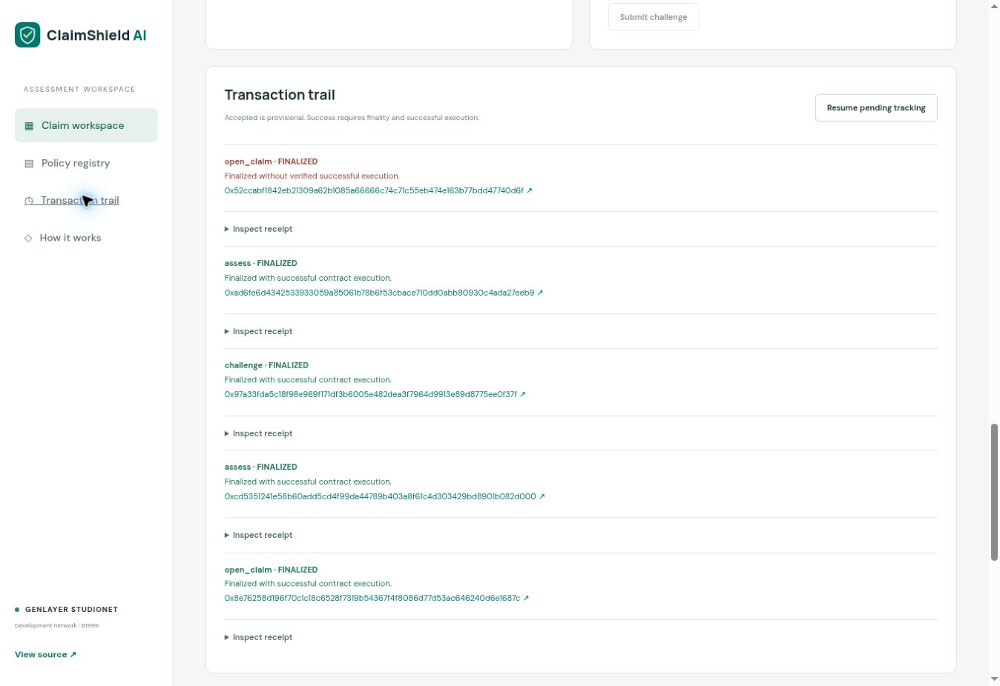

# Live verification evidence

Verified 26–27 October 2026 on **stable Studionet, chain 61999**. All 15 transactions below finalized with `MAJORITY_AGREE`, `leader_only=false`, and `execution_mode=NORMAL`. Fourteen executed successfully; the deliberately duplicated claim produced the expected execution error. See [machine-readable receipts](live-transactions.json) and [finalized state](live-state.json).

## Contract and website

- Contract: [0x2B50Ecb7BE683A3e08Ee9d89700D28C80ba24B70](https://explorer-studio.genlayer.com/address/0x2B50Ecb7BE683A3e08Ee9d89700D28C80ba24B70)
- Publisher/deployer: `0xf3C059C1495C80c4C94D4eB9eA43FE2fd5D6ED88`, Studio's built-in account.
- Constructor publisher: `amzar1st/ClaimShield-AI`.
- Source-matched implementation commit: [7d810cae2624299f9a88ef596e6c7805e2cfdfbb](https://github.com/amzar1st/ClaimShield-AI/commit/7d810cae2624299f9a88ef596e6c7805e2cfdfbb). The contract is unchanged in subsequent documentation/UI/CI commits.
- Deployed-source SHA-256: `69706ed22f2b96cd53bbf429e4e900264a3547db516b761c93fa95b1724c2234`. [Direct current-code verification](source-verification.json) compares RPC-retrieved code bytes with the repository source and deployment configuration.
- Public website: https://claimshield-ai.tinymule33.chatgpt.site . Anonymous HTTP access returned 200, and deployed JS, stylesheet, configuration and fixture manifest matched local artifact hashes. The live browser loaded the app and read finalized state without sign-in.
- Final website release: Sites version 2, source commit `07fbac605ca47fd8d6c3ffdeab3dcd967ef63221`, deployment `appgdep_6ae0a60a7acc81918e714dfdae8a1508` succeeded on 27 October. Hosting source includes the built bundle; GitHub supplies the complete reproducible source and lockfile, with `npm run build` generating the bundle.

## Finalized transactions

| Operation | Transaction | Observed result |
| --- | --- | --- |
| Deployment | [0xd08ed02b…e82025](https://explorer-studio.genlayer.com/transactions/0xd08ed02b204293b10349a9a6f1ffda28523301fac53433690f1e143cd4e82025) | Studio built-in account; full consensus |
| Register policy | [0xc57c4391…2f6c6b](https://explorer-studio.genlayer.com/transactions/0xc57c4391295c13968528082b1c93617980f9e4bef9d26309afe85a10ff2f6c6b) | Immutable CS-MOTOR-2026 |
| Open positive claim | [0x889c2701…9f97a2](https://explorer-studio.genlayer.com/transactions/0x889c27018679c07c459434add92c845a3cb42f9447a3520ead5c50bf009f97a2) | CS-DEMO-001; Studio built-in account |
| Positive assessment | [0xda0a356e…b5a96e](https://explorer-studio.genlayer.com/transactions/0xda0a356ef1823ce12988d95425ba140aa4c7e3988dbb62b5d5290f41ecb5a96e) | SUPPORTED |
| Conflicting evidence challenge | [0x6c4739e5…e09141](https://explorer-studio.genlayer.com/transactions/0x6c4739e538037bb5ce06bf6fdea68d9a95d3c2c3448eaae63389398641e09141) | Original result preserved; second round opened |
| Conflict re-assessment | [0x0968fff8…4f90ee](https://explorer-studio.genlayer.com/transactions/0x0968fff8cafcad1e25b01337286dd2661cf12f49828cf09e39d28b86fc4f90ee) | NEEDS_REVIEW |
| Open excluded claim | [0x0c3ea047…9eaa34](https://explorer-studio.genlayer.com/transactions/0x0c3ea047ea8293e790ee6b7354bc9f90974aa915838a9e986b4aae2dac9eaa34) | CS-WEB-EXCLUDED; public browser |
| Exclusion assessment | [0x3b046c0b…b0fdb9](https://explorer-studio.genlayer.com/transactions/0x3b046c0be32a7ecc0a54fb653df748d4f9e8fcb1f64be5bb5ec5b7e1ecb0fdb9) | NOT_SUPPORTED |
| Open bad-hash claim | [0x13796acf…ec680b](https://explorer-studio.genlayer.com/transactions/0x13796acf6ad60678a4cc708399e23256f5583e5d944535177f3a6518c8ec680b) | CS-WEB-MISSING; public browser |
| Bad-hash assessment | [0xf73d251c…11be4c](https://explorer-studio.genlayer.com/transactions/0xf73d251c6f1197969b73d0072889596374185d5dd3240591d18c1a657a11be4c) | INSUFFICIENT_EVIDENCE; HASH_MISMATCH recorded |
| Open recovery scenario | [0x8e76258d…e1687c](https://explorer-studio.genlayer.com/transactions/0x8e76258d196f70c1c18c6528f7319b54367f4f8086d77d53ac646240d6e1687c) | CS-WEB-RECOVERY-20261027; final public UI |
| Recovery initial review | [0xcd535124…82d000](https://explorer-studio.genlayer.com/transactions/0xcd5351241e58b60add5cd4f99da44789b403a8f61c4d303429bd8901b082d000) | INSUFFICIENT_EVIDENCE |
| Recovery challenge | [0x97a33fda…e0f37f](https://explorer-studio.genlayer.com/transactions/0x97a33fda5c18f98e969f171df3b6005e482dea3f7964d9913e89d8775ee0f37f) | Correctly hashed pinned incident report appended |
| Recovery second review | [0xad6fe6d4…27eeb9](https://explorer-studio.genlayer.com/transactions/0xad6fe6d4342533933059a85061b78b6f53cbace710dd0abb80930c4ada27eeb9) | SUPPORTED; original bad attachment remains individually excluded |
| Duplicate claim rejection | [0x52ccabf1…740d6f](https://explorer-studio.genlayer.com/transactions/0x52ccabf1842eb21309a62b1085a66666c74c71c55eb474e163b77bdd47740d6f) | Expected execution ERROR; no duplicate claim created |

## Current records and decision commitments

The demo retains all four verdicts in current records, with SUPPORTED and INSUFFICIENT_EVIDENCE also preserved across recovery history. `CS-DEMO-001` initially recorded SUPPORTED and now records NEEDS_REVIEW after conflicting evidence. No original assessment was overwritten. All six recorded decision hashes were independently recomputed from canonical JSON and matched.

| Claim | Round (API index) | Verdict | Decision SHA-256 |
| --- | --- | --- | --- |
| CS-DEMO-001 | 0 | SUPPORTED | `6da76a324f43e0c0d83e2fcb18bb8a14ad44fc22654d56242df51e0083d140bc` |
| CS-DEMO-001 | 1 | NEEDS_REVIEW | `ba6d9f510a894d908109e7856edf1b34ee502fed4b6479b59e0149b678d60e7f` |
| CS-WEB-EXCLUDED | 0 | NOT_SUPPORTED | `5aa390ba3301a9870f4503936c43fc71fc630281dc862878f0cb6881be55e416` |
| CS-WEB-MISSING | 0 | INSUFFICIENT_EVIDENCE | `a1565717fa35dcde3b26aa067c359666c1450326ed8a0dc7d3fcdbcb09c98574` |
| CS-WEB-RECOVERY-20261027 | 0 | INSUFFICIENT_EVIDENCE | `70871ec6a69c10078bbe0530c5e685c6c0ac0befb9b59935abbbeb9142c7fae3` |
| CS-WEB-RECOVERY-20261027 | 1 | SUPPORTED | `33a6ba1ad229ee039c8d87e9e697db28d999b5acc6f8a07247a49b67040d8983` |

## Automated checks

- **48 direct-mode contract tests passed**: source restrictions, immutable policies, ownership, duplicate inputs, size/date bounds, safe failed-source handling, verdict derivation, invalid model schemas/line IDs, forged leader citations, independent validator disagreement, challenge capacity and immutable history. [Output](test-results.txt).
- **17 frontend transaction tests passed**: pending phases, unresolved consensus, finality, failed execution, rejected consensus, resumable timeout and receipt retry. [Output](frontend-tests.txt).
- **GenVM lint and SDK semantic validation passed**, exposing 10 public methods: six views and four writes. [Output](genvm-validation.txt).
- [Clean GitHub Actions verification](https://github.com/amzar1st/ClaimShield-AI/actions/runs/40512355107) passed the test, build and GenVM validation steps after the pinned-bundle bootstrap fix. The workflow runs on future pushes and pull requests.

Direct tests mock external web/model responses and do not claim distributed-consensus proof. The live transactions above separately demonstrate real retrieval, model execution, independent validators and finalized state.

## Browser verification

The public UI was used to create temporary accounts, submit claims, inspect all verdict categories, submit a recovery challenge, run the second assessment, load both history rounds, and observe an expected failed duplicate transaction. Reloading during a pending transaction preserved the demo account/hash and resumed tracking without resubmission. Reviewed-round assessment buttons are hidden; a second challenge is disabled. The UI marks an earlier result as awaiting re-review while new evidence is pending. Studio's built-in account was used for deployment, publisher registration and the complete positive → challenge → re-assessment sequence. Studio keys were never exported into the public frontend; there is no MetaMask dependency.

## Reviewer reproduction

1. Open the public website, then load `CS-WEB-RECOVERY-20261027`, `CS-WEB-EXCLUDED`, `CS-WEB-MISSING`, or `CS-DEMO-001` to inspect finalized records without an account.
2. Expand **Decision commitment and history** and choose **Load all review rounds** to inspect immutable history.
3. Create a disposable demo account and choose a scenario. Keep a unique internal claim ID; the incident reference identifies the supplied fictional report.
4. Submit, wait for final successful consensus, assess, and inspect source quotations/statuses. Use the **Hash mismatch** scenario to reproduce INSUFFICIENT_EVIDENCE.
5. For that scenario, expand the challenge form and select **Verified recovery report**. Submit the challenge, wait for finality and assess again. The correctly hashed source can support the claim while the original invalid attachment remains explicitly excluded.
6. For a supported accidental-collision claim, select **Conflicting report** instead to reproduce NEEDS_REVIEW. Only the claim owner or publisher administrator may write to an existing claim.

## Limits and release history

This is a fictional-data, public-text development demonstration. It is not a verified insurer integration, payout system, real-person eligibility determination or production deployment. Studionet can reset. No real insurance outcome, private evidence processing, production-network behavior, independent audit or adoption is claimed. No promotional post or video was published; public source, receipts and screenshots supply the demonstration evidence.

An experimental pre-release contract and a leader-only diagnostic identified quotation-transcription fragility. The corrected release uses deterministic source-line selection and was deployed once after that material source change. Those experimental receipts are separate in `initial-live-receipts.json`; they are not included in the 15 full-consensus release transactions above. The unchanged corrected contract was not redeployed during final frontend and CI fixes.
